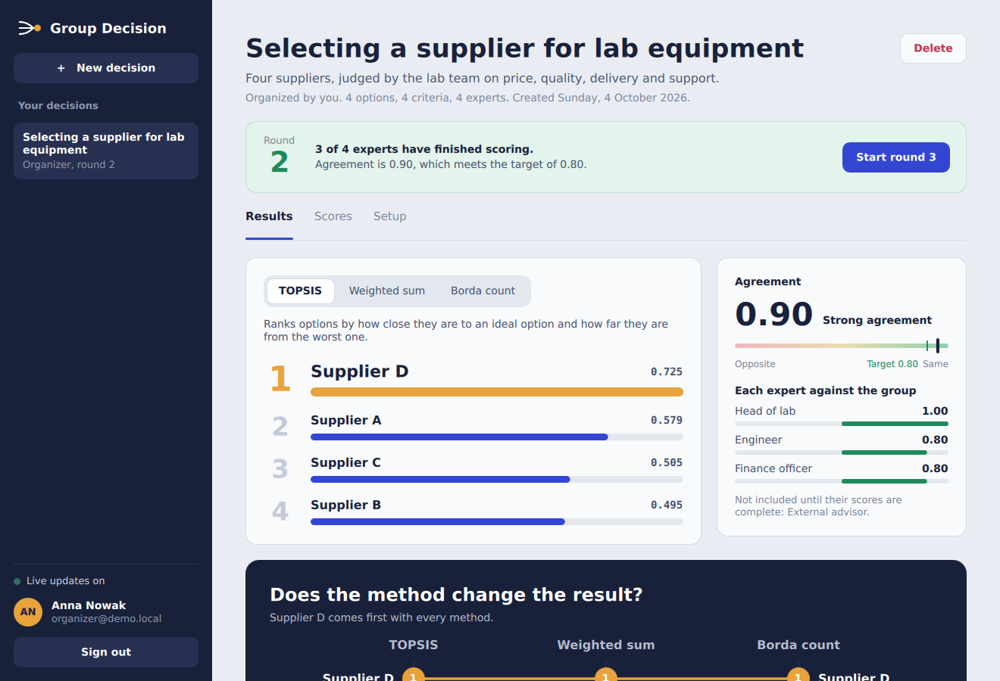
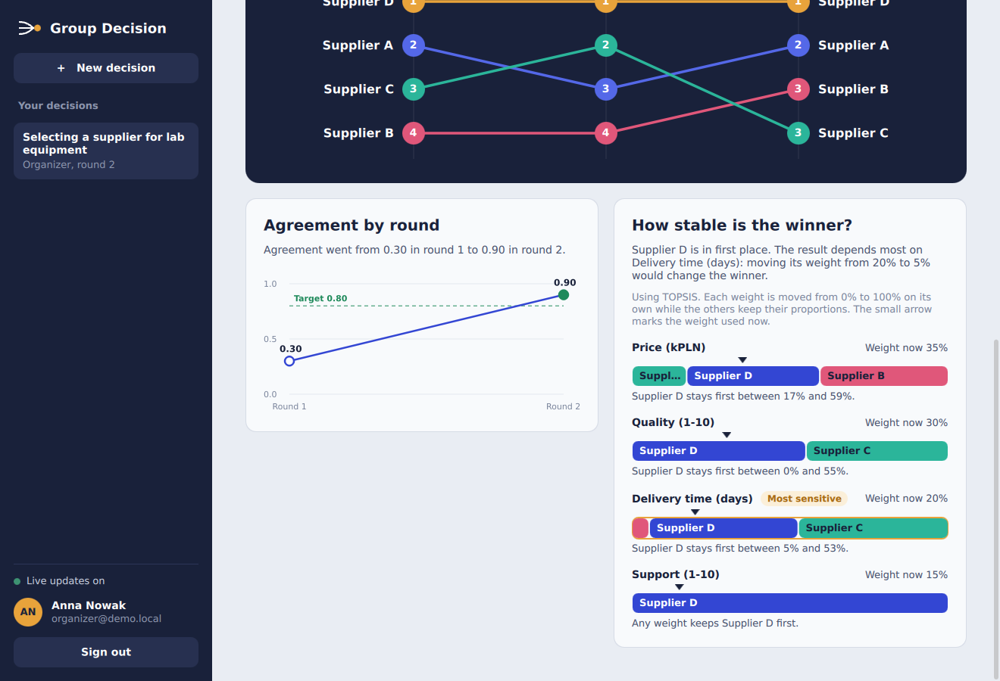
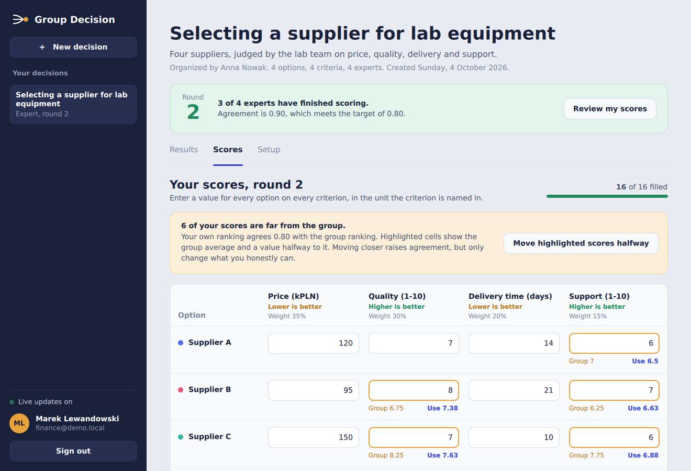

# Group Decision (Qt / QML)

A desktop app for **multi-criteria group decision making**. Several experts score a set of options
on weighted criteria. The app combines their opinions into one group ranking, measures how much
the experts agree, and runs **consensus rounds** until agreement is high enough.

Built with **C++17, Qt 6, QML, CMake, SQLite and Qt Test**.



| | |
|---|---|
|  |  |

## Features

- **Accounts and roles.** The person who creates a decision is its organizer. Experts are invited
  by email and can only enter their own scores. Passwords are stored as salted PBKDF2 hashes.
- **Three group decision methods:**
  - **TOPSIS** on the weighted mean of all experts' scores
  - **Weighted sum** (min-max scaling) on the same weighted mean
  - **Borda count**: each expert ranks with TOPSIS, and the rankings are combined by weighted points
- **Agreement level**: weighted mean Spearman correlation between each expert's ranking and the group ranking.
- **Method comparison chart**: shows whether the winner changes between methods.
- **Consensus rounds**: the organizer starts a new round when agreement is below the target. Each expert
  then sees which of their scores are far from the group, with a suggested value halfway to it.
- **Sensitivity analysis**: for each criterion, the weight range in which the winner stays the same,
  and which criterion the result depends on most.
- **Live updates**: open the app twice with different accounts. When one person saves scores,
  the other window updates within a second.
- **Unit tests** for the algorithms and for the app rules (37 tests).

## Requirements

- **Qt 6.5 or newer** (Qt 6.8 LTS recommended), with the *Qt Quick* and *Qt Quick Controls* modules.
  It also builds with Qt 6.4.
- **CMake 3.21+** and a **C++17 compiler** (MSVC 2019/2022 or MinGW on Windows, GCC or Clang on Linux/macOS).
- Nothing else: SQLite comes with Qt.

## Build and run

### Option 1: Qt Creator (easiest)

1. Open Qt Creator, then **File → Open File or Project** and pick `CMakeLists.txt` in this folder.
2. Choose a kit (for example *Desktop Qt 6.8 MSVC2022 64-bit* or *MinGW 64-bit*) and click **Configure Project**.
3. Pick **GroupDecisionApp** as the run target and press **Run** (Ctrl+R).

### Option 2: command line

On Windows, open the Qt command prompt for your kit (for example *Qt 6.8 (MinGW)*) so Qt is on the PATH.

```bash
cmake -S . -B build -DCMAKE_BUILD_TYPE=Release
cmake --build build --config Release
```

Run it:

```bash
build/app/GroupDecisionApp            # Linux / macOS
build\app\Release\GroupDecisionApp.exe  # Windows with MSVC
build\app\GroupDecisionApp.exe          # Windows with MinGW
```

If CMake cannot find Qt, tell it where Qt is installed, e.g.
`-DCMAKE_PREFIX_PATH=C:/Qt/6.8.0/msvc2022_64`.

### Run the tests

```bash
ctest --test-dir build --output-on-failure -C Release
```

The service tests take about 20 seconds, because password hashing is slow on purpose.

### Make a folder you can copy to another Windows PC

```bash
windeployqt --qmldir app/qml build\app\Release\GroupDecisionApp.exe
```

This copies the Qt DLLs and QML plugins next to the `.exe`.

## Demo accounts

On first start the app creates a database with an example decision (choosing a supplier, two rounds).
All demo accounts use the password **`Demo123!`**, and the sign-in page has one-click buttons for them.

| Email | Role |
|---|---|
| organizer@demo.local | Organizer of the example decision |
| head@demo.local | Expert |
| engineer@demo.local | Expert |
| finance@demo.local | Expert |

`advisor@demo.local` is invited but has no account yet. Choose **Create account** with that email,
and the invitation is linked to the new account.

**To see live updates:** start the app a second time, sign in as a different user, and save scores in one window.

**Where the data is:** the database file path is printed when the app starts (in Qt Creator: *Application Output*).
On Windows it is usually `C:\Users\<you>\AppData\Roaming\GroupDecision\GroupDecision\groupdecision.db`.
Delete that file to start again with fresh demo data, or start the app with `--db <file>` to use another file.

## How the project is organized

The code is split into four parts, from the inside out. Each part only uses the ones above it.

```
core/      Decision algorithms. Plain C++17, no Qt. Could be reused in any program.
backend/   SQLite storage, accounts and the app's rules. Uses Qt, but has no UI.
app/       The desktop app: C++ classes that QML can use, and the QML screens.
tests/     Qt Test unit tests for core/ and backend/.
```

How a click turns into a result, for example when an expert saves scores:

```
ScoresTab.qml  →  DecisionController::saveScores()  →  DecisionService::saveScores()
   (QML)              (app/, turns QML data            (backend/, checks the user may do it)
                       into C++ types)                          ↓
                                                        DecisionStore::saveScores()  →  SQLite
                                                           (backend/, only SQL)
Results come back the same way: DecisionService loads the scores, builds a gd::GroupProblem,
and calls gd::solve() in core/.
```

## Every file explained

### Top level

| File | What it does |
|---|---|
| `CMakeLists.txt` | Main build file. Finds Qt, sets C++17, and adds the four parts below. |
| `README.md` | This file. |
| `.gitignore` | Keeps build folders, IDE files and local databases out of Git. |
| `docs/screenshots/` | Pictures used in this README. |

### `core/` – the decision engine (plain C++)

| File | What it does |
|---|---|
| `CMakeLists.txt` | Builds the static library `gdcore`. Turns on all compiler warnings. |
| `include/groupdecision/Types.h` | Basic types: `Criterion`, `Matrix` (a small row-by-row matrix), `ExpertInput`, `RankedOption`, `GroupResult`, and the `Method` and `CriterionType` enums. |
| `include/groupdecision/GroupProblem.h` | `GroupProblem`: options, criteria and expert scores together. |
| `src/GroupProblem.cpp` | Checks the input when a `GroupProblem` is created (at least two options, weights not negative, every expert has a full score matrix, no NaN). Throws `std::invalid_argument` otherwise. |
| `include/groupdecision/Methods.h` | Declares the single-matrix methods. |
| `src/Methods.cpp` | **TOPSIS** (vector normalization, weighting, ideal and anti-ideal points, relative closeness), **weighted sum** with min-max scaling, and **Borda points** with fair handling of ties. |
| `include/groupdecision/Statistics.h` | Declares the rank statistics. |
| `src/Statistics.cpp` | **Average ranks** (ties share the average rank) and **Spearman correlation**. |
| `include/groupdecision/Engine.h` | Declares `solve()`, `winners()` and `aggregateMatrix()`. |
| `src/Engine.cpp` | Combines experts: weighted mean of their matrices for TOPSIS and weighted sum, weighted Borda for Borda. Builds the ranking (equal scores share a rank) and the agreement level. |
| `include/groupdecision/ConsensusFeedback.h` | Types for feedback to one expert. |
| `src/ConsensusFeedback.cpp` | For each of an expert's scores: distance from the group (scaled by how spread out that criterion is), whether it is far (above 0.2), and a value halfway to the group. |
| `include/groupdecision/Sensitivity.h` | Types for sensitivity results. |
| `src/Sensitivity.cpp` | Moves one criterion's share of the weight from 0% to 100% (others keep their proportions), checks 200 points, then narrows down each change of winner by bisection. Finds the stable range and the most sensitive criterion. |

### `backend/` – storage, accounts and rules

| File | What it does |
|---|---|
| `CMakeLists.txt` | Builds the static library `gdbackend` (Qt Core, Sql, Network). |
| `AppError.h` | The error type for problems the user can fix: `Validation`, `Auth`, `Forbidden`, `NotFound`, `Conflict`. The message is ready to show in the UI. |
| `Domain.h` | Plain data structs shared by storage, rules and UI: `User`, `Decision` (with options, criteria, experts and scores per round), input structs for a new decision, and result structs such as `ResultView` and `SensitivityView`. |
| `Database.h` / `Database.cpp` | Opens the SQLite connection, turns on foreign keys and WAL mode, creates the tables and indexes, and runs queries with bound values (no SQL injection). `dataVersion()` is used for live updates. Also has a small `Transaction` class that rolls back automatically if something throws (RAII). |
| `PasswordHasher.h` / `.cpp` | Hashes passwords with PBKDF2-SHA256 and a random salt, and checks them with a constant-time comparison. |
| `DecisionStore.h` / `.cpp` | All SQL for decisions: load a whole decision, list a user's decisions, insert, delete, save scores (insert or update), copy scores into a new round, and a version number that goes up on every change. No rules here. |
| `AuthService.h` / `.cpp` | Register, sign in and look up users. Gives the same message for an unknown email and a wrong password. Links earlier invitations when someone registers. |
| `DecisionService.h` / `.cpp` | **The rules.** Who can see a decision (others get "not found"), experts score only themselves, only the organizer starts rounds or deletes, a new round needs two complete experts. Turns stored scores into a `gd::GroupProblem` (skipping experts who have not finished) and calls the engine. |
| `SeedData.h` / `.cpp` | Creates the demo accounts and the example decision with two rounds on first start. |

### `app/` – the desktop app

| File | What it does |
|---|---|
| `CMakeLists.txt` | Builds the executable `GroupDecisionApp`. `qt_add_qml_module` registers the C++ classes for QML and packs all QML files into the program. |
| `main.cpp` | Starts the app: reads the optional `--db` option, sets the default font and the *Basic* Controls style, creates the `AppController`, and loads `Main.qml`. |
| `AppController.h` / `.cpp` | Creates and owns the database, services, `Session`, `DecisionListModel` and `DecisionController`. Checks SQLite's `data_version` every second; when another window has saved something, it reloads the list and the open decision (live updates). |
| `Session.h` / `.cpp` | The signed-in user as QML sees it: `signedIn`, name, email, initials, last error, and `signIn()`, `registerAccount()`, `signOut()`. |
| `DecisionListModel.h` / `.cpp` | A `QAbstractListModel` with the user's decisions for the sidebar (title, role, round). |
| `DecisionController.h` / `.cpp` | The open decision. Has properties (title, round, options, criteria, experts...) and methods QML calls (`result()`, `compare()`, `history()`, `sensitivity()`, `scores()`, `feedback()`, `saveScores()`, `startNextRound()`, `create()`...). Converts C++ results into `QVariantMap`/`QVariantList` and catches `AppError` so QML never sees an exception. |

### `app/qml/` – the screens

| File | What it does |
|---|---|
| `Main.qml` | The window. Shows the sign-in page or the workspace, and the messages (toasts). |
| `Theme.qml` | A singleton with all colors, sizes and small helpers (percent and number formatting, method names). |
| `LoginPage.qml` | Sign in or create an account, plus one-click demo accounts. The left side has an animated drawing made with `Canvas`. |
| `Workspace.qml` | After sign-in: sidebar on the left, and on the right the open decision, the new-decision form, or an empty state. |
| `Sidebar.qml` | Logo, *New decision* button, the list of decisions (`ListView` on `DecisionListModel`), live-update status and the account. |
| `DecisionPage.qml` | One decision: title and details, the round bar, and the three tabs. Uses a `StackLayout` so unsaved scores survive a tab switch. Asks before deleting. |
| `RoundBar.qml` | Current round, how many experts are done, agreement against the target. The organizer can start the next round (with a confirmation). |
| `ResultsTab.qml` | Puts the results panels together and recalculates them when the decision changes. |
| `RankingList.qml` | The group ranking with large rank numbers and score bars. |
| `AgreementPanel.qml` | Agreement level on a scale from "opposite" to "same", the target, and each expert against the group. |
| `MethodComparison.qml` | Slope chart: the rank of every option under each method, drawn with `Canvas` plus QML items. Crossing lines mean the method matters. |
| `AgreementHistory.qml` | Line chart of agreement per round with the target as a dashed line (`Canvas`). |
| `SensitivityPanel.qml` | One track per criterion showing which option wins at each weight, with a marker at the current weight. |
| `ScoresTab.qml` | The score grid. Experts edit their own scores (invalid values are blocked, unsaved cells are marked). The organizer can view each expert. From round 2 on, far-off cells are highlighted with the group value and a suggestion. |
| `SetupTab.qml` | Options, criteria weights (benefit or cost) and expert influence. |
| `NewDecisionPage.qml` | The form for a new decision: options, criteria, experts, the "add me as an expert" box and the agreement target. Rows are kept in `ListModel`s. |

### `app/qml/components/` – small reusable pieces

| File | What it does |
|---|---|
| `AppButton.qml` | One button for the whole app, with kinds: primary, secondary, quiet, danger, link, dark. |
| `AppField.qml` | Text input with red (invalid), blue (unsaved) and orange (far from group) borders. |
| `Card.qml` | White rounded panel that stacks its children in a column. |
| `Segmented.qml` | A row of choices with one selected (used for the methods and for sign in / create account). |
| `ConfirmDialog.qml` | "Are you sure?" dialog. |
| `Toast.qml` | Short messages in the corner that disappear after a few seconds. |
| `Avatar.qml` | Round badge with initials. |
| `Tag.qml` | Small rounded label, such as "Most sensitive". |
| `EmptyState.qml` | Title and text for when there is nothing to show yet. |
| `Logo.qml` | The logo, drawn with `Shape`. |

### `tests/`

| File | What it does |
|---|---|
| `CMakeLists.txt` | Builds the two test programs and registers them with CTest. |
| `tst_engine.cpp` | 19 tests of `core/`: TOPSIS, weighted sum, Borda ties, ranks, Spearman, input checks, reference results for the example (checked against an independent NumPy implementation), feedback and sensitivity. |
| `tst_service.cpp` | 18 tests of `backend/` on a fresh in-memory database each time: password hashing, sign-in errors, registration checks, invitation linking, who may see and change what, results, rounds, and a whole decision from start to finish. |

## Database tables

`users`, `decisions`, `options`, `criteria`, `experts`, `evaluations`.
An evaluation is one score: *expert × option × criterion × round*. Deleting a decision deletes everything
that belongs to it (`ON DELETE CASCADE`). `experts.user_id` is empty until the invited person creates an account.

## Design choices and limits

- **One program, no server.** Everything runs locally and the data is one SQLite file. Several windows
  (or several app instances on the same computer) can share it, and they see each other's changes.
  It is not meant for many people on different computers. That would need a server, like the
  ASP.NET Core version of this project.
- **Live updates by polling.** Once a second the app asks SQLite whether another connection has committed.
  It is simple and cheap, but changes appear with up to one second of delay.
- **QML gets plain maps and lists.** The C++ results are turned into `QVariantMap`/`QVariantList`.
  That keeps the QML simple. A larger app would use more `QAbstractListModel` classes, like the sidebar does.
- **A decision cannot be edited after it is created** (options, criteria and experts are fixed). Scores can
  be changed at any time in the current round.
- **Password hashing** uses 100,000 PBKDF2 iterations, which is fine for a local demo app.

## Background

This project comes from my PhD work on group decision support systems at AGH University of
Krakow, where combining the opinions of several experts is a core problem.

Vahid Moeinifar
vmoeinifar@agh.edu.pl
